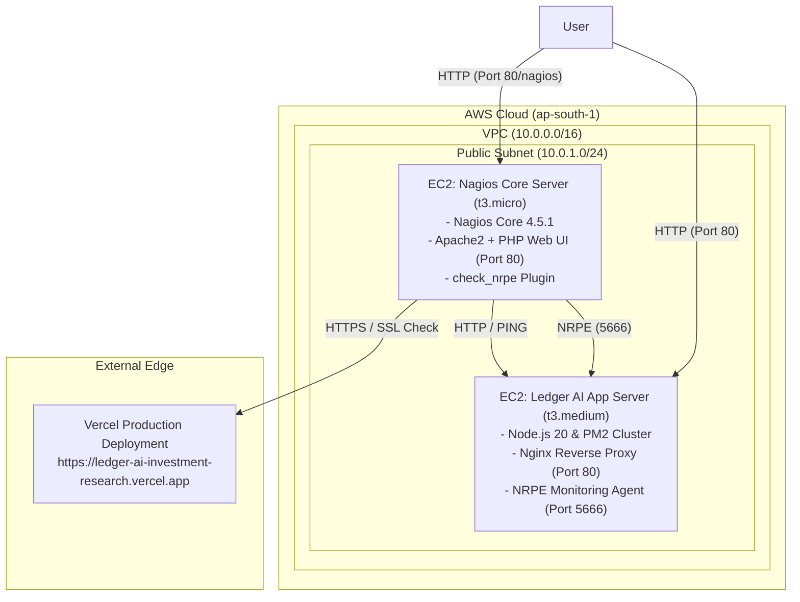

# Ledger AI – DevOps Infrastructure & Monitoring Pipeline
**Course:** INT 333 - DevOps Advance Configuration Management  
**Student:** Hemant Kumar (Reg No: 12307937, Roll: 37, Section: K2O2314)  
**Institution:** Lovely Professional University  

---

## 🏗️ Architecture Overview



---

## 🚀 Step-by-Step Runbook

### Step 1: Provision Infrastructure with Terraform
```powershell
cd devops/terraform
terraform init
terraform plan
terraform apply -auto-approve
```
*Outputs: EC2 Public IPs, SSH connection commands, and automatically generates `devops/ansible/inventory/hosts.ini`.*

### Step 2: Base System Hardening & Tools (Ansible)
```bash
cd devops/ansible
ansible-playbook -i inventory/hosts.ini playbooks/01_base_setup.yml
```

### Step 3 & 4: Application Deployment (Ansible)
```bash
ansible-playbook -i inventory/hosts.ini playbooks/02_app_deployment.yml
```
*Deploys Node.js 20, pulls code from GitHub, sets up PM2 in cluster mode, configures Nginx reverse proxy.*

### Step 5: Install & Configure Nagios Core (Ansible)
```bash
ansible-playbook -i inventory/hosts.ini playbooks/03_nagios_server_install.yml
ansible-playbook -i inventory/hosts.ini playbooks/04_setup_monitoring_checks.yml
```
*Access Nagios Dashboard at: `http://<NAGIOS_PUBLIC_IP>/nagios` (User: `admin`, Password: `LedgerAI@2026`).*

### Step 6: Failure Simulation & Automated Recovery
1. **Simulate failure:**
   ```bash
   ansible-playbook -i inventory/hosts.ini playbooks/05_simulate_failure.yml -e "scenario=pm2"
   ```
2. **Observe alert:** Check Nagios web interface to confirm service turns **CRITICAL (RED)**.
3. **Execute auto-healing:**
   ```bash
   ansible-playbook -i inventory/hosts.ini playbooks/06_recovery_service.yml
   ```
4. **Confirm recovery:** Verify Nagios service status returns to **OK (GREEN)**.
